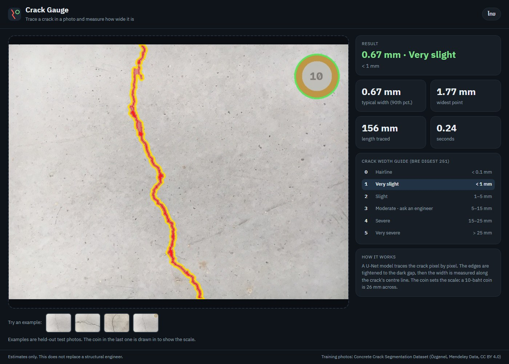
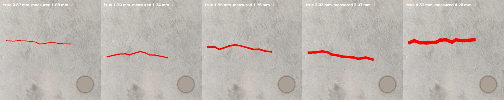

# Crack Gauge

Trace a crack in a photo and measure how wide it is, in millimetres, using a 10-baht coin as the ruler.



After the March 2025 earthquake, a lot of people in Bangkok started looking hard at the cracks in
their own walls. The question they usually have is simple: is this just the plaster, or should an
engineer see it? Width is the first thing an engineer asks about, and it is hard to judge by eye.

This is an early prototype that answers one narrow question: how wide is this crack?

## How it works

1. A U-Net with a ResNet-34 encoder (ImageNet weights) traces the crack pixel by pixel.
2. The model is trained not to miss cracks, so its outline runs a few pixels wide. Before
   measuring, the outline is tightened to the dark gap itself: holes inside the trace are filled,
   then only pixels darker than a local Otsu threshold are kept.
3. The crack is thinned to a centre line. At every point on that line, the distance to the edge
   gives half the local width.
4. A 10-baht coin (26 mm) sets the scale. The coin is found with a Hough transform, then the
   circle is re-fitted to the outer rim using edges from all three colour channels, because a brass
   rim on grey concrete can be the same brightness but a different colour.
5. The typical width (90th percentile along the crack) is mapped to the crack categories in BRE
   Digest 251 as a plain-language guide.

## Results

**Tracing**, on 69 test photos the model never saw (threshold chosen on 69 validation photos):

| Precision | Recall | F1 (2 px tolerance) | IoU |
|---|---|---|---|
| 0.96 | 0.89 | **0.92** | **0.80** |

The 2-pixel tolerance is the usual way crack papers score thin structures: a trace that is one
pixel off a 3-pixel-wide crack is still a correct trace. Strict IoU is reported too.

**Measuring.** Real crack photos don't come with true widths, so the measurement was checked on
dark bands of exact, known width drawn onto real concrete from crack-free parts of the test photos,
with a coin-sized disc for scale. 40 cases, full pipeline from photo to millimetres:

| True width | 0.87 mm | 1.30 mm | 1.95 mm | 3.03 mm | 4.33 mm |
|---|---|---|---|---|---|
| Measured (mean) | 1.04 | 1.38 | 1.94 | 3.02 | 4.25 |

Millimetres were given in 20 of the 40 cases, with a mean absolute error of **0.08 mm**. In the
other 20 the grey disc was too close to the concrete in colour for its rim to be found, and the app
now refuses to give millimetres rather than guess a scale (an earlier version guessed, was about 10%
off on those, and averaged 0.16 mm over all 40). Without the edge-tightening step the error is
0.85 mm. This is a synthetic check: it tests the measuring, not how well the model sees unusual
real cracks.



**Speed:** about 0.14 s per photo on a GTX 1650 (about 2 s on CPU).

## What went wrong along the way

- The GPU (GTX 1650) produced NaN with half-precision training. Training runs in fp32.
- Some source photos end in `.JPG`, which silently broke the pairing of photos and masks on the
  first run. The prepare script now uses the file stem.
- On wide cracks the final model traced both edges and left the middle hollow, so a 4.3 mm crack
  measured 1.8 mm. Filling enclosed holes fixed it. There is a test for it now.
- Hough on its own put the coin radius about 10% off, which goes straight into the millimetres.
  Re-fitting to the rim fixed that.
- Hough also offers a circle on bare concrete. One example photo got a "coin" that was not there,
  which erased the cracks inside it and reported made-up millimetres. A coin now has to have an
  edge at least 60% of the way round its rim.
- The web app marked only the widest point, and the traced line was 1–3 px wide, so on a real
  photo it looked like one small circle on a long crack. The whole crack now gets a halo and outline.

## Run it

```bash
pip install -r requirements.txt
python -m pytest

python -m scripts.prepare_data <path>/concrete D:/crack-data/prepared
python -m scripts.train D:/crack-data/prepared D:/crack-data/runs/unet34
python -m scripts.evaluate D:/crack-data/prepared D:/crack-data/runs/unet34/best.pt
python -m scripts.validate_width D:/crack-data/prepared D:/crack-data/runs/unet34/best.pt
python -m scripts.serve D:/crack-data/runs/unet34/best.pt      # http://127.0.0.1:8820
```

The trained weights are not in the repo (about 100 MB); training takes about an hour on a GTX 1650.

## Limits

- Trained on 458 close-up photos of concrete surfaces. Painted walls, tiles and very dark photos
  are untested.
- The example with a coin in the web app has a drawn coin. A real photo with a real coin is next.
- Estimates only. This does not replace a structural engineer.

## Credits

Training data: Çağlar Fırat Özgenel, *Concrete Crack Segmentation Dataset*, Mendeley Data, V1,
doi:10.17632/jwsn7tfbrp.1, CC BY 4.0. Photos were resized for training.

Aphisit Aoonu · [LinkedIn](https://www.linkedin.com/in/aphisit-aoonu/)
